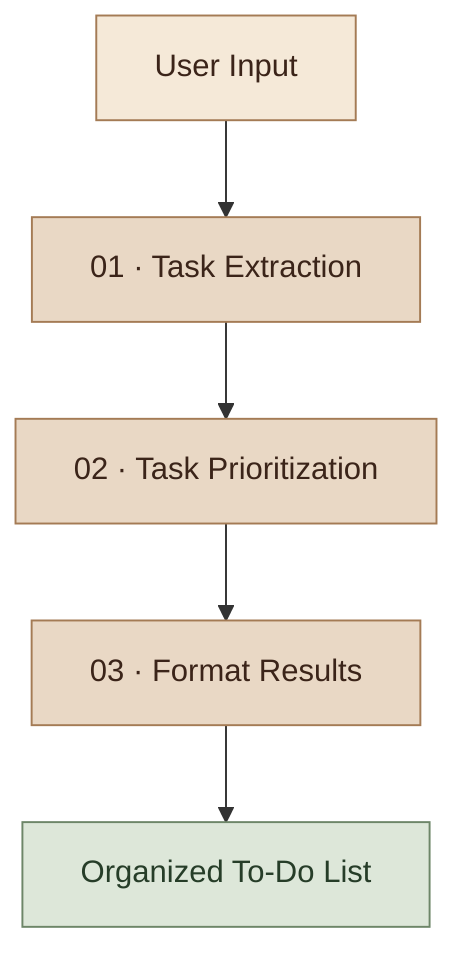

 <div align="center">

<a href="https://github.com/haniaeman2026-pixel/IntelliTask-AI">
  
</a>

<a href="https://git.io/typing-svg">
  
</a>

<br/>

**An AI-powered assistant that transforms everyday instructions into structured, prioritized to-do lists.**

<br/>


</div>

---

## Overview

IntelliTask AI simplifies task management by converting informal natural-language instructions into individual tasks, assigning priority levels, preserving explicitly stated deadlines, and generating an organized to-do list.

Instead of manually organizing every activity, users can describe their plans in one sentence and let the AI-powered workflow structure the information.

## Workflow Architecture

<div align="center">



</div>

### 01 — Task Extraction

Identifies individual activities, separates multiple tasks, and extracts explicitly stated deadline phrases.

### 02 — Task Prioritization

Assigns **High**, **Medium**, or **Low** priority based on the AI model's interpretation of urgency and importance.

### 03 — Format Results

Combines the processed information into a readable to-do list containing task titles, priorities, available deadlines, and the total task count.

## Example

**Input**

> I need to complete my assignment tomorrow, prepare for my meeting next week, and buy groceries today.

**Generated Output**

```text
INTELLITASK AI
AI-POWERED TASK MANAGEMENT ASSISTANT
==========================================

1. Complete assignment
   Priority: High
   Due date: tomorrow

2. Prepare for meeting
   Priority: Medium
   Due date: next week

3. Buy groceries
   Priority: High
   Due date: today

Total tasks: 3
```

<sub>Example output; priorities may vary depending on the model's interpretation.</sub>

## Key Features

| Feature | Description |
|---|---|
| Natural-Language Input | Accepts everyday task descriptions. |
| Automatic Extraction | Separates activities into individual tasks. |
| AI Prioritization | Assigns High, Medium, or Low priority. |
| Due-Date Extraction | Preserves explicitly stated deadline phrases. |
| Workflow Orchestration | Connects three sequential LangGraph nodes. |
| Structured Validation | Uses Pydantic schemas for output validation. |
| Automated Testing | Includes tests for formatting and graph structure. |
| Secure Configuration | Loads API credentials through environment variables. |

## Technology Stack

<div align="center">

| Technology | Role |
|:---:|---|
| **Python** | Core application logic |
| **LangGraph** | Workflow orchestration |
| **LangChain Groq** | Language-model integration |
| **Groq API** | Task extraction and prioritization |
| **Pydantic** | Structured data validation |
| **python-dotenv** | Environment configuration |
| **pytest** | Automated testing |

</div>

## Project Structure

```text
IntelliTask-AI/
│
├── src/
│   ├── __init__.py
│   ├── state.py
│   ├── schemas.py
│   ├── llm.py
│   ├── graph.py
│   └── nodes/
│       ├── __init__.py
│       ├── extract_tasks.py
│       ├── prioritize_tasks.py
│       └── format_results.py
│
├── tests/
│   └── test_workflow.py
│
├── main.py
├── requirements.txt
├── .env.example
├── .gitignore
├── README.md
└── NOTES.md
```

## Getting Started

### 1. Clone the repository

```bash
git clone https://github.com/haniaeman2026-pixel/IntelliTask-AI.git
cd IntelliTask-AI
```

### 2. Create and activate a virtual environment

**Windows PowerShell**

```powershell
py -m venv .venv
.\.venv\Scripts\Activate.ps1
```

### 3. Install dependencies

```powershell
python -m pip install -r requirements.txt
```

### 4. Configure environment variables

Create a `.env` file in the project root:

```env
GROQ_API_KEY=your_actual_groq_api_key
GROQ_MODEL=openai/gpt-oss-20b
```

Replace the placeholder with your own API key and use a model identifier supported by your Groq account.

**Security:** Never upload `.env` or expose your API key in a public repository.

### 5. Run IntelliTask AI

```powershell
python main.py
```

Enter your task description when prompted. Type `exit` to close the application.

## Testing

Run the automated test suite:

```powershell
python -m pytest -q
```

The current test suite covers result formatting, empty task lists, and the presence of the three workflow nodes.

**Development verification:** 3 tests passed.

## Core Concepts

- Large Language Model (LLM) integration
- Natural-language processing
- Sequential AI workflow design
- LangGraph state management
- Structured output validation
- API configuration and environment variables
- Automated software testing

## Current Limitations

- The current application uses a command-line interface.
- Tasks are not persisted between sessions.
- Priority assignments depend on the language model.
- Relative deadlines are stored as text rather than converted to calendar dates.
- A working Groq API configuration and internet connection are required.

## Future Enhancements

- Professional graphical user interface
- Persistent task storage
- Task editing and completion tracking
- Deadline reminders
- Calendar integration
- Task analytics

*These are potential future improvements, not features of the current version.*

---

<div align="center">

### Built with Python, LangGraph & Groq API

**Organize tasks. Prioritize smarter. Work more efficiently.**

<br/>

**Hania Eman**  
*AI & Data Science Student · Python & Machine Learning Enthusiast*

<br/>

<a href="https://github.com/haniaeman2026-pixel/IntelliTask-AI">
  
</a>

</div>


