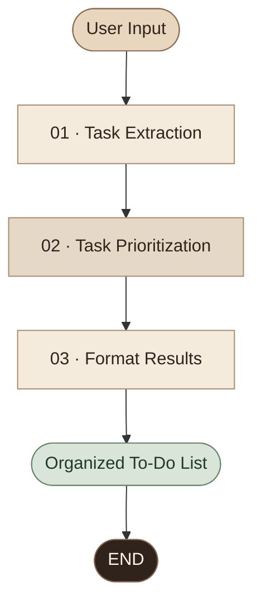

<div align="center">


<br/>


<br/>

**An AI-powered assistant that turns everyday task descriptions into organized, prioritized to-do lists.**

<br/>


</div>

---

## ✦ Overview

**IntelliTask AI** is an intelligent task management project built with Python, LangGraph, and the Groq API.

It takes informal, natural-language task descriptions and processes them through a three-node AI workflow to extract individual tasks, assign priority levels, and generate a structured to-do list.

### The idea

Instead of manually organizing every activity, simply describe what needs to be done.

**Example input**

> I need to complete my assignment tomorrow, prepare for my meeting next week, and buy groceries today.

**Organized output**

```text
INTELLITASK AI
AI-POWERED TASK MANAGEMENT ASSISTANT
==========================================

1. Complete assignment
   Priority: High
   Due date: tomorrow

2. Prepare for meeting
   Priority: Medium
   Due date: next week

3. Buy groceries
   Priority: High
   Due date: today

Total tasks: 3
```

*Priority assignments depend on the model's judgment and may vary.*

---

## ✦ Workflow Architecture

<div align="center">



</div>

### 01 — Task Extraction

- Identifies actionable tasks from natural-language input.
- Separates multiple activities into individual tasks.
- Extracts explicitly stated due-date phrases.
- Structures extracted information using Pydantic schemas.

### 02 — Task Prioritization

- Assigns High, Medium, or Low priority.
- Preserves task titles and extracted deadlines.
- Validates the returned task count.
- Uses AI judgment to estimate relative importance.

### 03 — Format Results

- Formats prioritized tasks into a readable list.
- Displays available due dates and priorities.
- Provides a total task count.
- Handles empty task lists.

---

## ✦ Key Features

| Feature | Description |
|---|---|
| Natural-language input | Describe tasks in everyday language |
| Task extraction | Identify separate actionable activities |
| AI prioritization | Assign High, Medium, or Low priority |
| Deadline extraction | Preserve explicitly stated deadline phrases |
| Workflow orchestration | Connect three sequential LangGraph nodes |
| Structured validation | Validate model outputs with Pydantic |
| Readable results | Generate an organized terminal-based to-do list |
| Automated testing | Verify core formatting and workflow structure |

---

## ✦ Technology Stack

<div align="center">

| Technology | Role |
|:---|:---|
| **Python** | Application logic |
| **LangGraph** | Three-node workflow orchestration |
| **LangChain Groq** | Groq model integration |
| **Groq API** | Language-model inference |
| **Pydantic** | Structured data validation |
| **python-dotenv** | Environment configuration |
| **pytest** | Automated testing |

</div>

---

## ✦ Project Structure

```text
IntelliTask-AI/
│
├── src/
│   ├── __init__.py
│   ├── state.py
│   ├── schemas.py
│   ├── llm.py
│   ├── graph.py
│   │
│   └── nodes/
│       ├── __init__.py
│       ├── extract_tasks.py
│       ├── prioritize_tasks.py
│       └── format_results.py
│
├── tests/
│   └── test_workflow.py
│
├── main.py
├── requirements.txt
├── .env.example
├── .gitignore
├── README.md
└── NOTES.md
```

---

## ✦ Installation & Setup

### 1. Clone the repository

```bash
git clone https://github.com/haniaeman2026-pixel/IntelliTask-AI.git
cd IntelliTask-AI
```

### 2. Create a virtual environment

**Windows PowerShell**

```powershell
py -m venv .venv
.\.venv\Scripts\Activate.ps1
```

### 3. Install dependencies

```powershell
python -m pip install -r requirements.txt
```

### 4. Configure environment variables

Create a `.env` file in the project root:

```env
GROQ_API_KEY=your_actual_groq_api_key
GROQ_MODEL=openai/gpt-oss-20b
```

Replace the placeholder with your own valid Groq API key. Use a model ID supported by your Groq account.

### 5. Run IntelliTask AI

```powershell
python main.py
```

Enter a description of your tasks when prompted.

To close the application, type `exit`.

---

## ✦ Testing

Run the test suite:

```powershell
python -m pytest -q
```

The current test suite covers:

- Task formatting.
- Empty task handling.
- Three-node workflow structure.

**Verified development result:** `3 passed in 5.24s`

---

## ✦ Concepts Demonstrated

- Large Language Model integration
- Natural-language task processing
- State-based graph workflows
- Sequential AI pipeline design
- Structured outputs and schema validation
- Environment-based API configuration
- Automated testing with pytest

---

## ✦ Future Enhancements

- [ ] Professional graphical user interface
- [ ] Persistent task storage with SQLite
- [ ] Edit and delete task functionality
- [ ] Task completion tracking
- [ ] Deadline reminders
- [ ] Calendar integration
- [ ] User-adjustable priorities

*These are potential future improvements, not features of the current version.*

---

## ✦ Current Limitations

- The current application runs in a command-line interface.
- Tasks are not saved between sessions.
- Priority assignments depend on model interpretation.
- Relative deadlines are retained as phrases, not converted into calendar dates.
- A working Groq API configuration and internet connection are required.

---

## ✦ Author

<div align="center">

### Hania Eman

**AI & Data Science Student | Python & Machine Learning Enthusiast**

Building practical AI applications and intelligent workflow solutions.

<br/>

*Organize tasks. Prioritize smarter. Work with clarity.*

<br/>

**IntelliTask AI · Built with Python, LangGraph & Groq API**

</div>
